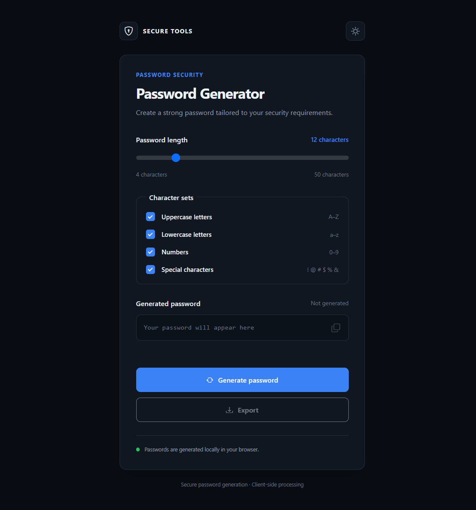

# Password Generator

[](https://developer.mozilla.org/en-US/docs/Web/HTML)
[](https://developer.mozilla.org/en-US/docs/Web/CSS)
[](https://developer.mozilla.org/en-US/docs/Web/JavaScript)

A standalone, client-side password generator implemented with HTML, CSS, and vanilla JavaScript. It generates passwords in the browser, supports light and dark themes, and does not require a backend, Django, or React. The page links to Bootstrap 5 CSS and Bootstrap Icons from public CDNs for form styling and icons; password generation and application behavior use vanilla JavaScript.

## Preview



## Features

- Select a password length from 4 to 50 characters.
- Include any combination of uppercase letters, lowercase letters, numbers, and symbols. At least one character from each selected set is included.
- Use the Web Crypto API (`crypto.getRandomValues`) for random selection and shuffling.
- Copy the generated password to the clipboard, with a fallback for browsers without the Clipboard API.
- Export the generated password as `generated-password.txt`.
- Switch between light and dark themes. The selected theme is saved in local storage; the initial theme follows the browser preference.
- Password generation runs locally in the browser.

## Repository structure

```text
assets/preview.png
css/style.css
html/index.html
js/script.js
README.md
```

## Installation and launch

```bash
git clone https://github.com/mihaiapostol14/Bootstrap-Generator-Password-Form-v2.git
cd Bootstrap-Generator-Password-Form-v2
```

Open `html/index.html` in a browser. Alternatively, open the repository in Visual Studio Code, open `html/index.html`, and launch it with the Live Server extension. The page loads Bootstrap CSS and Bootstrap Icons from CDNs, so those resources require an internet connection. Browser clipboard access may also require a secure context, such as `localhost` when using a local development server.

## Source files

- `html/index.html` — generator interface and external stylesheet links.
- `css/style.css` — application styles, theme variables, responsive layout, and reduced-motion handling.
- `js/script.js` — password generation, copy/export actions, feedback, and theme persistence.

## Useful documentation

- [MDN: HTML](https://developer.mozilla.org/en-US/docs/Web/HTML)
- [MDN: CSS](https://developer.mozilla.org/en-US/docs/Web/CSS)
- [MDN: JavaScript](https://developer.mozilla.org/en-US/docs/Web/JavaScript)
- [MDN: Web Crypto API](https://developer.mozilla.org/en-US/docs/Web/API/Web_Crypto_API)
- [Bootstrap 5 documentation](https://getbootstrap.com/docs/5.3/) — used for CSS styling classes.
- [Bootstrap Icons](https://icons.getbootstrap.com/) — icon font loaded by the page.

## Author

[Mihai Apostol](https://github.com/mihaiapostol14)

## License

This project has no open-source license. All rights are reserved by the author for future commercial use.